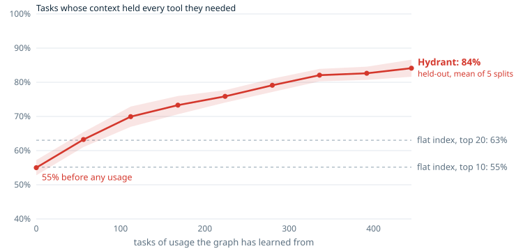
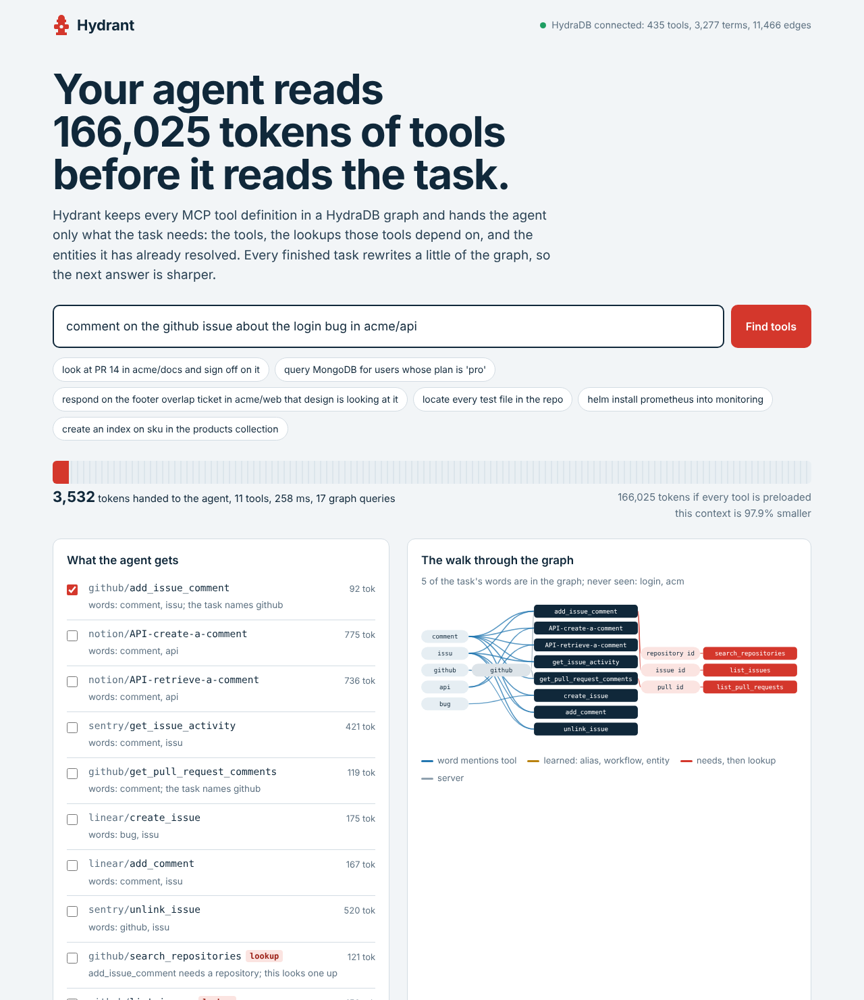

# Hydrant

**Context on tap for agents. Built on [HydraDB](https://github.com/hydra-db/hydradb).**

An agent connected to 27 MCP servers reads **166,025 tokens** of tool definitions before it reads the task.
Hydrant keeps every definition in a HydraDB graph and hands the agent only what the task needs: the tools, the
lookups those tools depend on, and the entities it has already resolved. Every finished task rewrites a little
of the graph, so the next answer is sharper.

- Live demo: `<your live link>`
- Walkthrough: `<your Loom link>`





## Result

741 hand-written tasks over 435 real tool definitions, split at random into a usage stream (60%)
and a held-out set (40%), 5 different splits, run on a HydraDB 0.4.0 node. A context is **complete**
when it holds every tool the task needs; one missing tool fails the task.

| system | complete context | multi-tool tasks | tools | context tokens | tool calls |
|---|---|---|---|---|---|
| preload-all (today) | 100.0% ± 0.0 | - | 435.0 | 166,025 | 1.27 |
| flat top-5 | 44.9% ± 1.5 | 9.9% ± 3.5 | 4.9 | 2,109 | 1.27 |
| flat top-8 | 50.5% ± 2.0 | 15.8% ± 3.3 | 7.7 | 3,353 | 1.27 |
| flat top-10 | 55.1% ± 2.6 | 21.1% ± 5.3 | 9.5 | 4,211 | 1.27 |
| flat top-20 | 63.0% ± 1.7 | 30.3% ± 4.2 | 18.1 | 8,317 | 1.27 |
| Hydrant, round 0 (no learning) | 55.0% ± 2.2 | 28.7% ± 2.8 | 8.3 | 3,488 | 1.27 |
| Hydrant, round 8 (445 tasks seen) | 84.1% ± 2.5 | 84.8% ± 4.7 | 7.6 | 2,888 | 1.18 |
|   same learned graph, read without traversal (term weights only) | 75.3% ± 2.3 | 57.5% ± 4.5 | 7.3 | 3,055 | 1.27 |
|   ... without requirement and workflow hops | 81.7% ± 1.5 | 76.3% ± 6.3 | 7.1 | 2,760 | 1.18 |
|   ... without alias hops | 80.1% ± 2.8 | 75.2% ± 4.1 | 7.8 | 3,228 | 1.18 |
|   ... without entity memory | 83.0% ± 3.0 | 80.4% ± 6.2 | 7.6 | 2,887 | 1.27 |

Mean ± standard deviation over 5 splits. Tokens are estimated at 4 characters per token.

What the numbers say:

- **It learns.** Held-out complete-context rate goes from 55.0% to 84.1% as the graph sees 445 tasks,
  and the curve is still rising at the end of the stream: 55 → 63 → 70 → 73 → 76 → 79 → 82 → 83 → 84 (% after each batch).
- **It is small.** 2,888 tokens per task against 166,025: 98.3% smaller.
- **The graph does the work.** The same learned weights read without traversal score 75.3%. Traversal adds
  8.9 points overall and 27.3 points on multi-tool tasks, where the tool that must run first
  shares no words with the request.
- **A flat index does not get there by returning more.** Top 20 from a flat index is 63.0% at
  8,317 tokens.
- **It saves round trips.** Remembered entities cut the oracle's tool calls per task from 1.27 to 1.18.

### Under load

`bench/load.py` on 2 cores, client and HydraDB node on the same host; 20 s per level; one resolve in five also writes an outcome back (edge reweighting while reads continue).

| concurrent agents | resolves / s | p50 ms | p95 ms | p99 ms | outcome writes | errors |
|---|---|---|---|---|---|---|
| 1 | 19.6 | 31.4 | 70.0 | 117.7 | 87 | 0 |
| 8 | 24.8 | 154.3 | 443.4 | 868.1 | 95 | 0 |
| 32 | 18.6 | 224.7 | 1790.0 | 2516.4 | 92 | 0 |
| 64 | 21.1 | 555.3 | 4366.6 | 5903.5 | 111 | 0 |

Catalog scaled by cloning every server, 8 concurrent agents, reads only:

| tools | edges | ingest s | resolves / s | p50 ms | p95 ms | errors |
|---|---|---|---|---|---|---|
| 435 | 11,466 | 10.9 | 90.6 | 79.3 | 167.4 | 0 |
| 2,175 | 57,438 | 64.1 | 23.5 | 184.3 | 1270.5 | 0 |
| 4,350 | 114,903 | 90.5 | 13.8 | 324.4 | 1950.6 | 0 |

No errors at any level. With the word-edge cache off (every hop read from HydraDB every time) the same mix at 8 agents runs at 10.7 resolves/s, p50 609.4 ms. The HydraDB node, its indexer and the single-process Python load generator share the same two cores here and the node is CPU-bound, so these are floors for this box, not the engine's ceiling. Outcome writes are serialised per Hydrant process.

## How it works

### The graph

```
(Server)-[:PROVIDES]->(Tool)
(Term)-[:MENTIONS {p, l, w}]->(Tool)     a word points at a tool. p = prior from the definition,
                                         l = learned, w = max(0, p + l)
(Term)-[:NAMES {p, c}]->(Server)         "slack" names slack; learned: "pod" names kubernetes
(Tool)-[:NEEDS]->(Resource)              slack_post_message needs a channel id
(Resource)-[:YIELDED_BY {w}]->(Tool)     slack_list_channels can look one up
(Term)-[:MEANS {c}]->(Term)              learned alias: "pr" means "pull_request"
(Tool)-[:THEN {w}]->(Tool)               learned workflow: search_issues, then add_issue_comment
(Term)-[:DENOTES {w}]->(Entity)          learned: "releases" is channel C04REL9K2
(Resource)-[:HOLDS]->(Entity)
```

Ingest builds the first five edge types from the MCP definitions alone: field-weighted BM25 weights for
MENTIONS, and NEEDS / YIELDED_BY from input schemas (a required `channel_id` is a need; a `list_channels` tool
on the same server yields it). No embeddings and no LLM call anywhere: the graph is the index.

### One resolve: a five-step walk, every hop concurrent with its siblings

1. Point-read the Term nodes for the task's words.
2. `Term-[:MEANS]->Term` (learned aliases), `Term-[:NAMES]->Server`, `Term-[:DENOTES]->Entity`.
3. `Term-[:MENTIONS]->Tool` for the words and their aliases, and `Server-[:PROVIDES]->Tool`.
4. From the best tools: `Tool-[:NEEDS]->Resource` and `Tool-[:THEN]->Tool` through HydraDB's batched adjacency
   read, then `Resource-[:YIELDED_BY]->Tool` and the workflow weights for the edges that exist. A needed
   resource that a remembered entity already satisfies drops its lookup tool and puts the entity's id in the
   context instead.
5. Read the definitions of the tools that made it.

### The learning loop (Track 1)

Every reported outcome (the tools actually called, in order) changes the graph:

| mechanism | what is written |
|---|---|
| edge reweighting | MENTIONS weights rise for tools that were needed and missed or outranked, fall for tools offered in their place. Error-driven: a correct answer moves nothing, so weights do not drift. |
| gap-driven ingestion | A word the graph had never seen becomes a Term node wired to the tool it should have found. |
| entity (concept) merge | Words that keep arriving with tools named something else become MEANS aliases; words that keep arriving with one server become NAMES edges. One alias sharpens every tool behind its target. |
| path compression | Tools used in sequence get a direct THEN edge, so a two-hop walk through a Resource (or no path at all) becomes one hop. |
| lookup pruning | YIELDED_BY weights rise for lookups that were used and decay for lookups offered and ignored, until they stop being offered. |
| entity memory | A resolved entity becomes an Entity node reachable from its name; the lookup round trip is skipped next time. |

### The agent context layer (Track 2)

Hydrant is one MCP server with three tools (about 540 tokens in the window):

- `find_tools(task)` returns the tool definitions and resolved entities the task needs.
- `call_tool(context_id, tool, arguments)` proxies to the real server (configured in `upstreams.json`) and
  records the call, so the graph learns from what agents do without being told.
- `report_outcome(context_id, used_tools, resolved_entities)` for agents that call tools on their own connection.

```json
{"mcpServers": {"hydrant": {"type": "http", "url": "https://<your-host>/mcp/"}}}
```

## How HydraDB is used

Everything Hydrant knows is in HydraDB: definitions, vocabulary, weights, workflows, entities. The process
holds no index of its own. `hydrant/hydra_store.py` is the whole database layer, a handful of primitives over Bolt, each one a
statement that was run against a 0.4.0 `graph-node`:

```cypher
-- upserts: nodes by integer id, edges by a stable edge id, properties set in the same statement
UNWIND $rows AS row MERGE (n {id: row.id}) SET n:Tool, n.key = row.key, n.defn = row.defn
UNWIND $rows AS row MATCH (a:Term {id: row.src}), (b:Tool {id: row.dst})
  MERGE (a)-[r:MENTIONS {id: row.eid}]->(b) SET r.p = row.p, r.l = row.l, r.w = row.w
-- a weighted hop: id-anchored, so it is a point lookup rather than a label scan
MATCH (a:Term {id: $id})-[r:MENTIONS]->(b) RETURN b.id AS dst, r.w AS w
-- topology for many sources in one request, served from the traversal index
UNWIND $rows AS row MATCH (a {id: row.id})-[:NEEDS]->(b) RETURN row.id AS src, b.id AS dst
-- the edges from many words into one tool, read before an outcome rewrites them
MATCH (a:Term)-[r:MENTIONS]->(b:Tool {id: $d}) WHERE a.id IN $ids RETURN a.id AS src, r.p AS p, r.l AS l
```

Measured on the node: an id-anchored pattern costs about 1.7 ms plus 0.35 ms per edge, the batched adjacency
read about 5 ms plus 0.06 ms per edge, and `WHERE a.id IN [...]` on a pattern scans the label. So weighted hops
are concurrent anchored matches, property-free hops use the batched read, and a word's MENTIONS edges are
reused in-process for 30 seconds and dropped the moment an outcome rewrites them.

Design choices that follow from the engine: integer node ids (stable hashes of string keys), typed directed
edges for every hop, scoring in the application because `RETURN` projects properties and aggregates, and
idempotent upserts everywhere because writes auto-commit.

Would it fall apart on a plain store? The term weights alone would not: that is the "read without traversal"
row above, and it is 8.9 points worse. The lookup tools, workflows, aliases and entity substitution
are all multi-hop paths; in a key-value store each would be a hand-maintained secondary index.

## Run it

### With Docker

```bash
docker compose up -d --build      # builds HydraDB from source the first time: slow once, then instant
open http://localhost:8000
```

### Without Docker (Ubuntu 24.04 or WSL; how it was developed)

```bash
bash scripts/run_hydradb.sh                 # builds and starts graph-node + graph-indexer
pip install -e ".[dev]"
uvicorn hydrant.api:app --port 8000         # ingests the catalog on first start
```

### Tests and benchmark

```bash
pytest                                                           # unit tests on the reference store
HYDRANT_TEST_HYDRADB_URI=bolt://127.0.0.1:7687 pytest            # plus parity against HydraDB (wipes the graph)
python bench/run.py --store hydradb --seeds 5 --out bench/results/learning.json
python bench/load.py
```

## HTTP API

| | |
|---|---|
| `POST /api/resolve {task}` | context: tools with definitions, entities, tokens, the traversal trace |
| `POST /api/feedback {context_id, used, entities}` | apply an outcome; returns what changed in the graph |
| `GET /api/stats`, `GET /api/learned` | graph size; a sample of learned aliases, words, workflows, entities |
| `POST /api/live/replay {n}`, `POST /api/live/evaluate` | replay recorded usage; score the held-out set now |
| `POST /api/admin/reset` | back to the freshly ingested catalog |
| `/mcp/` | the MCP endpoint (streamable HTTP) |

## Benchmark protocol and limits

- **Tools are real.** `scripts/harvest_catalog.py` starts each public MCP server and records `tools/list`.
- **Tasks are hand-written** (`bench/build_tasks.py`, `bench/more_tasks.py`), phrased the way people ask rather
  than the way tools are named, with gold tools assigned from each tool's documented behaviour. Where several
  servers offer an equivalent tool, any of them counts.
- **Held-out means held-out.** Evaluation never writes to the graph. Settings were tuned on the usage stream
  only (`bench/tune.py`).
- **The agent is an oracle.** Outcomes come from the gold labels, so the curve measures how well the graph
  learns from correct feedback, not how well a model picks from the context. An LLM-in-the-loop run is the next
  measurement to add.
- **The baseline is lexical.** "Flat index" is the same BM25 weights without edges. An embedding index was not
  available in the build environment and is not compared.
- **Entities in the benchmark are synthetic** (twelve named channels, pages, projects and bases).
- **No transactions.** Concurrent outcomes on the same edge are last-writer-wins; updates are serialised per
  Hydrant process.

## Layout

```
hydrant/        ingest, hydra_store (HydraDB), resolver, learner, api, mcp_server, upstream
catalog/        435 tool definitions from 27 MCP servers
bench/          tasks, run.py (learning curve), load.py, tune.py, results/
web/            the demo UI (one static page)
tests/          unit tests and the HydraDB parity test
docs/           pitch, Loom script
```

MIT licensed.
